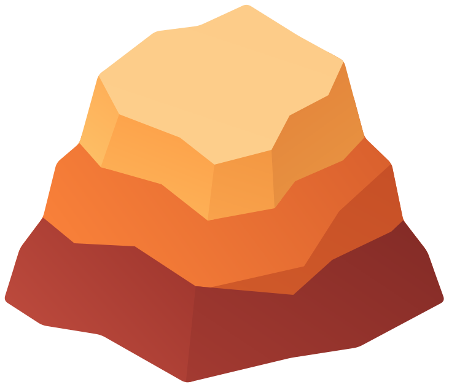
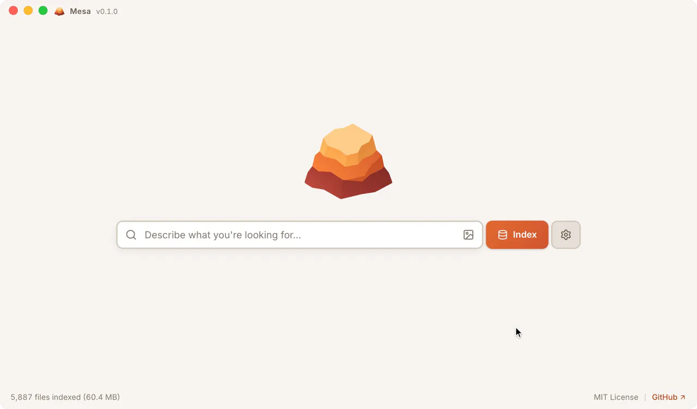
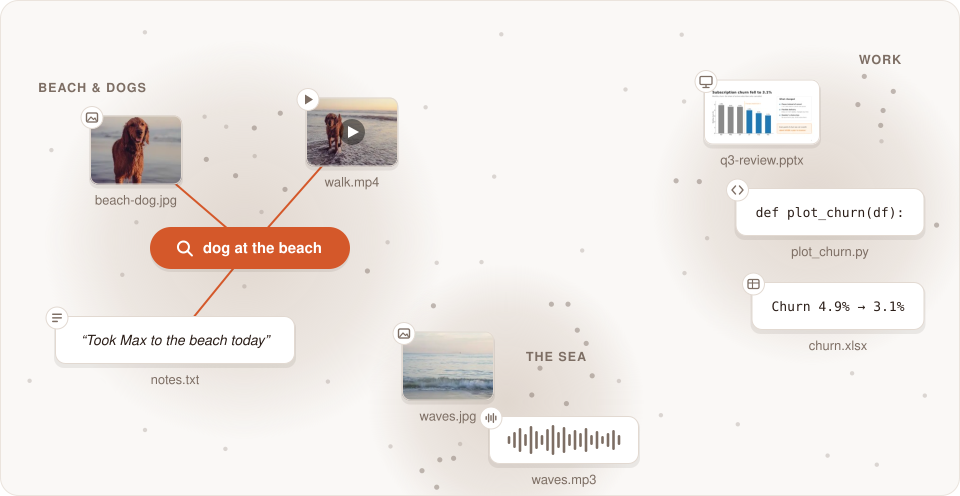
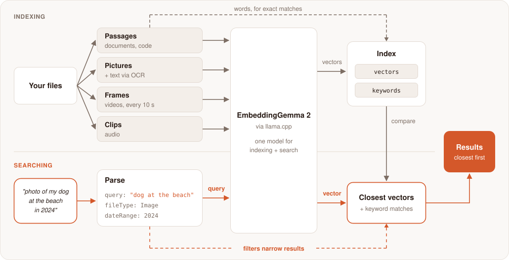

<p align="center">
  
</p>

<h1 align="center">Mesa</h1>

<p align="center">
  <strong>Find anything in your files.</strong><br>
  Search your documents, pictures, videos, recordings and code by what they say, show or sound like.
</p>

<p align="center">
  <a href="https://mesa.example">Website</a> ·
  <a href="https://github.com/biantsh/mesa/releases/latest">Download</a> ·
  <a href="#how-it-works">How it works</a>
</p>

<p>
<picture>
  <source media="(prefers-color-scheme: dark)" srcset="docs/demo-dark.webp">
  
</picture>
</p>

---

Mesa is a desktop search app for Windows, macOS and Linux. Instead of matching file names, it searches what's inside your files:

- **Search by meaning.** Describe what a file shows, says or sounds like: *"receipt from the hardware store"*, *"dog running on a beach"*, *"rain on a window"*.

- **Drop to search.** Drop a photo, song or document onto Mesa to find ones similar to it.

- **Combine clues.** Mix words with file types and dates: *"photo of my dog at the beach in 2024"*.

- **Open from anywhere.** Press a shortcut (default: <kbd>Alt</kbd>+<kbd>Space</kbd>, or <kbd>⌥</kbd>+<kbd>Space</kbd> on macOS) for a quick search window over whatever you're doing.

## How it works

Mesa is built on Google's [EmbeddingGemma 2](https://huggingface.co/ggml-org/embeddinggemma-2-GGUF). It understands text, pictures and sound, and turns them into vectors (points) in one shared space. A photo of a dog on a beach lands near the words *"dog at the beach"*, a recording of waves lands near a photo of the sea, and so on.

<p>
<picture>
  <source media="(prefers-color-scheme: dark)" srcset="docs/meaning-map-dark.svg">
  
</picture>
</p>

When a file is indexed, it turns into one or more of those vectors:

- **Documents** and **code** are split into passages, and each passage gets its own vector.
- **Pictures** get a vector for what they show. Text in them, like screenshots and scans, is read with [PaddleOCR](https://github.com/PaddlePaddle/PaddleOCR)'s PP-OCRv6 models, so you can search for it too.
- **Videos** are sampled about every 10 seconds, and each frame gets a vector.
- **Audio** is cut into short clips spread across the recording.

When you search, Mesa parses your natural language prompt into a structured query. *"photo of my dog at the beach in 2024"* becomes:

```json
{
  "fileType": "Image",
  "dateRange": ["Jan 2024", "Dec 2024"],
  "query": "dog at the beach"
}
```

The query (along with any attached files) gets turned into a vector, while the other fields act as filters. The files whose indexed vectors are closest to the query are then listed as final results.

<p>
<picture>
  <source media="(prefers-color-scheme: dark)" srcset="docs/how-it-works-dark.svg">
  
</picture>
</p>

All of this happens locally on your computer, with EmbeddingGemma 2 running through [llama.cpp](https://github.com/ggml-org/llama.cpp).

## Download and install

Get the latest version from the [Releases page](https://github.com/biantsh/mesa/releases/latest).

| System | Requirements | Download |
|---|---|---|
| **Windows** | Windows 10 or 11, x64 | `.exe` installer |
| **macOS** | macOS 13 or later, Apple silicon | `.dmg` disk image |
| **Linux** | Ubuntu 22.04 or later, or equivalent, x64 | `.deb`, `.rpm` or `.AppImage` |

When the app first starts, it downloads its models. Then, on the *Index* page, choose what to include: everything in your user folder, or specific folders and file types in the advanced view.

Indexing runs in the background at low priority by default, so it doesn't slow down your other processes.

## Build from source

Mesa is a [Tauri](https://tauri.app) app, with a Rust backend and a React/TypeScript interface. Search runs on [llama.cpp](https://github.com/ggml-org/llama.cpp), which is built from source along with the app.

### Prerequisites

- **All systems:** [Node.js](https://nodejs.org) 24, [Rust](https://rustup.rs) 1.96 or later, and [CMake](https://cmake.org)
- **Windows:** [VS Build Tools](https://visualstudio.microsoft.com/downloads/) (C++) and [Vulkan SDK](https://vulkan.lunarg.com)
- **macOS:** Xcode Command Line Tools
- **Linux:** the system packages below

<details>
<summary>Linux packages (Ubuntu)</summary>

```sh
sudo apt install \
  build-essential \
  git \
  gstreamer1.0-plugins-good \
  libayatana-appindicator3-dev \
  libgstreamer-plugins-base1.0-dev \
  libgstreamer1.0-dev \
  libheif-dev \
  librsvg2-dev \
  libssl-dev \
  libvulkan-dev \
  libwebkit2gtk-4.1-dev \
  pkg-config \
  python3
```

Building the AppImage also needs `meson`, `ninja-build`, `nasm` and `patchelf`.

</details>

### Build and run

```sh
git clone https://github.com/biantsh/mesa.git
cd mesa/app

npm ci

npm run build:runtime   # builds llama.cpp, and ONNX Runtime on Linux
npm run tauri dev       # run in development mode
```

To build installers for your system, run `npm run tauri build`.

## License

Mesa is released under the [MIT License](LICENSE). Third-party components and their licenses are listed in the app: click *MIT License* in the bottom corner of the main window.
